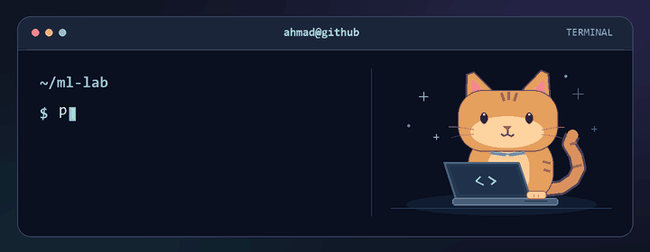

# Hi, I'm Ahmad Ali Javed 👋

**Data Science student at NUST (SEECS) · AI/ML builder · Islamabad, Pakistan**

## 👨‍💻 About me

- I train models in **PyTorch** and build apps with **Python**, **FastAPI**, and **LLMs**.
- At **Systems Limited**, I built RAG pipelines that ran with locally hosted models.
- I've co-authored two IEEE conference papers and a study on federated learning for computer vision.

## 🛠️ Projects

| Project | What I built |
| --- | --- |
| [DevLens](https://github.com/Ahmad3752/DevLens) | An AI app that extracts structured information from CVs and scores them across eight categories. |
| [Technical GraphRAG Assistant](https://github.com/Ahmad3752/technical-graphrag-assistant) | A document Q&A app that combines Elasticsearch and Neo4j to return answers with source citations. |
| [LLM Labs](https://github.com/Ahmad3752/LLM-LABS) | PyTorch experiments on training a Transformer from scratch, fine-tuning with LoRA, and measuring inference with and without KV caching. |
